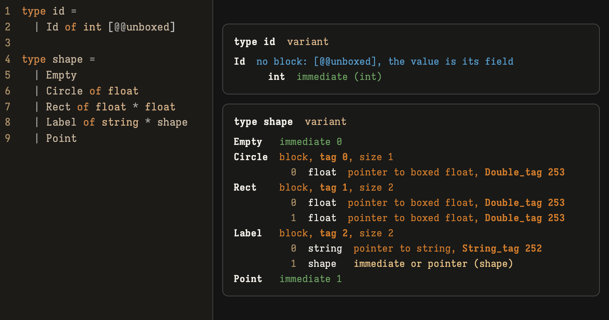

# lense-ocaml



`lense-ocaml` prints how each type in an OCaml file is represented at runtime: which constructors become *immediates*, which *tag* each heap block gets, when the compiler drops the block, and how first-class modules lay out their fields. It reads the representations from compiler-libs for OCaml 5.5, and from a vendored frontend for OxCaml. It also runs in a browser through `js_of_ocaml`.

```console
$ printf 'type t = A | B of int | C | D of string\n' | lense-ocaml -
type t  variant
  A  immediate 0
  B  block, tag 0, size 1
       0  int  immediate (int)
  C  immediate 1
  D  block, tag 1, size 1
       0  string  pointer to string, String_tag 252
```

## Building

```sh
nix build          # command-line tool, with tests
nix build .#web    # browser front end, as a static site in result/
```

Without Nix, `dune build` and `dune test` need OCaml 5.5 and dune.

## Usage

```sh
lense-ocaml [options] <file.ml | file.mli | file.cmt | file.cmti | -> ...
```

| Option | Effect |
| --- | --- |
| `--json` | Print JSON instead of text |
| `--type NAME` | Show only the named types |
| `--source` | Print each declaration above its representation |
| `--labels` | List polymorphic variant labels with their hashes, and report collisions |
| `--values` | Also show closures, lazy values and objects |
| `--backend native\|bytecode\|both` | Whose closures `--values` shows (default: native) |
| `--intf` | Read standard input as an `.mli` |
| `-I DIR` | Add `DIR` to the load path for `.cmi` files |
| `--compiler 5.5\|ox` | Read the input as OCaml 5.5 or OxCaml |
| `--ox-stdlib DIR` | Load the OxCaml standard library `.cmi` files from `DIR` |
